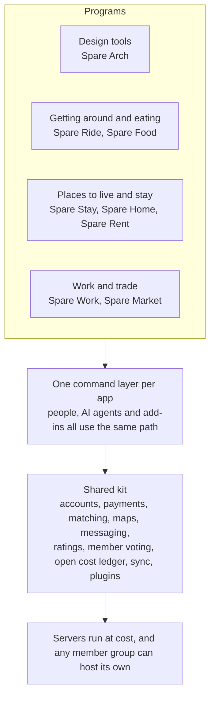

# Spareware Co-op

**Free software for working people, built from spare AI tokens. Owned by its members.**

Big platforms take a large cut from the people who do the work, and design software charges thousands a year just to be allowed to work. Spareware builds the replacements in the open. Every app takes only what it costs to run, and the people doing the work keep the rest.

## How it all fits together

Every program sits on one shared kit, so each new app gets accounts, payments, AI access and the open cost ledger from day one, and a fix to the kit improves every app at once.

## The programs

| Program | Replaces | Stage | Architecture |
| --- | --- | --- | --- |
| Shared kit | The parts every platform rebuilds | Mapping | [Map](https://github.com/spareware-co-op/spareware/blob/main/ARCHITECTURE.md) |
| Spare Arch | Revit, and the add-ins people buy for it | Mapping | [Map](https://github.com/spareware-co-op/spareware/blob/main/projects/spare-arch/ARCHITECTURE.md) |
| Spare Ride | Uber | Idea | Not mapped yet |
| Spare Food | Uber Eats, DoorDash | Idea | Not mapped yet |
| Spare Stay | Airbnb, Booking.com | Idea | Not mapped yet |
| Spare Home | Agent commissions and listing fees when selling a home | Idea | Not mapped yet |
| Spare Rent | Property manager and listing fees | Idea | Not mapped yet |
| Spare Work | Trades and freelance marketplaces | Idea | Not mapped yet |
| Spare Market | Trade Me, eBay, Etsy | Idea | Not mapped yet |

Stages run Idea, Mapping, Design, Build, Harden, Live. [Where everything is up to](https://github.com/spareware-co-op/spareware/blob/main/STATUS.md)

## What every program promises

- **At cost.** Fees cover only running costs, published every month on an open ledger.
- **Members own it.** Workers vote on their app's fees and rules.
- **Built legally, or not at all.** No copied proprietary code or assets, no decompiling, licences respected. [The full rules](https://github.com/spareware-co-op/spareware#built-legally-or-not-at-all)

## Give your spare tokens

Contributors point their leftover weekly AI tokens at a piece of work, building with Claude Opus 5.5 at Extra high effort or a newer, more capable model. A person reviews every piece before it lands.

**[Request to join](https://github.com/spareware-co-op/spareware/blob/main/CONTRIBUTING.md)** · [Discussions](https://github.com/spareware-co-op/spareware/discussions) · [The main repo](https://github.com/spareware-co-op/spareware)
