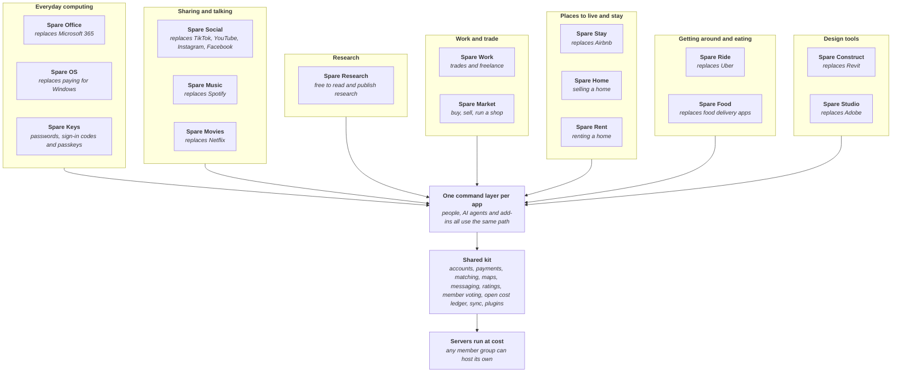

# Spareware Co-op

**Free software for everyone. Let's build it together with the spare weekly AI tokens we don't finish.**

**[See all the demos](https://spareware.app/demos.html)**: every program in one place, a tab each.

Most of us don't use all our AI tokens each week. Instead of letting them go to waste, point what's left at a piece of Spareware. Invited contributors pick a piece of work, their AI agent does it, and a person reviews every piece before it lands.

Every Spareware app is free for everyone to use, anywhere in the world. On the apps where people earn a living, like rides, food delivery, stays and trades, the workers keep all of the profit except the running costs: the servers and payment fees it takes to keep the app going. Nobody takes a cut on top.

**Always start with "Can we".** Every idea is met with how it could work, not why it won't. If it isn't possible yet, we work out what it would take.

## How it all fits together

Every program sits on one shared kit, so each new app gets accounts, payments, AI access and the open cost ledger from day one, and a fix to the kit improves every app at once.

## The programs

| Program | Replaces | Stage | Architecture |
| --- | --- | --- | --- |
| Shared kit | The parts every platform rebuilds | Mapping | [Map](https://github.com/spareware-co-op/spareware/blob/main/ARCHITECTURE.md) |
| Spare Construct | Revit, and the add-ins people buy for it | Mapping | [Map](https://github.com/spareware-co-op/spareware/blob/main/projects/spare-construct/ARCHITECTURE.md) |
| Spare Studio (working name) | Adobe's apps: Photoshop, Illustrator, InDesign, Premiere, After Effects, Lightroom, Acrobat and more | Mapping | [Map](https://github.com/spareware-co-op/spareware/blob/main/projects/spare-studio/ARCHITECTURE.md) |
| Spare Social (working name) | TikTok, YouTube, Instagram and Facebook, together | Mapping | [Map](https://github.com/spareware-co-op/spareware/blob/main/projects/spare-social/ARCHITECTURE.md) |
| Spare Music | Spotify | Mapping | [Map](https://github.com/spareware-co-op/spareware/blob/main/projects/spare-music/ARCHITECTURE.md) |
| Spare Movies | Netflix | Mapping | [Map](https://github.com/spareware-co-op/spareware/blob/main/projects/spare-movies/ARCHITECTURE.md) |
| Spare Research | Journal paywalls and the fees scientists pay to publish | Mapping | [Map](https://github.com/spareware-co-op/spareware/blob/main/projects/spare-research/ARCHITECTURE.md) |
| Spare Office | Microsoft 365: Word, Excel, PowerPoint, Outlook, Teams, OneNote, OneDrive | Mapping | [Map](https://github.com/spareware-co-op/spareware/blob/main/projects/spare-office/ARCHITECTURE.md) |
| Spare OS | Paying for Windows | Mapping | [Map](https://github.com/spareware-co-op/spareware/blob/main/projects/spare-os/ARCHITECTURE.md) |
| Spare Keys | Paid password managers and authenticator apps | Idea | [Map](https://github.com/spareware-co-op/spareware/blob/main/projects/spare-keys/ARCHITECTURE.md) |
| Spare Ride | Uber | Mapping | [Map](https://github.com/spareware-co-op/spareware/blob/main/projects/spare-ride/ARCHITECTURE.md) |
| Spare Food | Uber Eats, DoorDash | Mapping | [Map](https://github.com/spareware-co-op/spareware/blob/main/projects/spare-food/ARCHITECTURE.md) |
| Spare Stay | Airbnb, Booking.com | Mapping | [Map](https://github.com/spareware-co-op/spareware/blob/main/projects/spare-stay/ARCHITECTURE.md) |
| Spare Home | Agent commissions and listing fees when selling a home | Mapping | [Map](https://github.com/spareware-co-op/spareware/blob/main/projects/spare-home/ARCHITECTURE.md) |
| Spare Rent | Property manager and listing fees | Mapping | [Map](https://github.com/spareware-co-op/spareware/blob/main/projects/spare-rent/ARCHITECTURE.md) |
| Spare Work | Trades and freelance marketplaces | Mapping | [Map](https://github.com/spareware-co-op/spareware/blob/main/projects/spare-work/ARCHITECTURE.md) |
| Spare Market | Trade Me, eBay, Etsy, Shopify | Mapping | [Map](https://github.com/spareware-co-op/spareware/blob/main/projects/spare-market/ARCHITECTURE.md) |

Stages run Idea, Mapping, Design, Build, Harden, Live. [Where everything is up to](https://github.com/spareware-co-op/spareware/blob/main/STATUS.md)

## What every program promises

- **At cost.** Fees cover only running costs, published every month on an open ledger.
- **Workers keep the profit.** Everything except running costs goes to the people doing the work, and they vote on their app's fees and rules.
- **Built legally, or not at all.** No copied proprietary code or assets, no decompiling, licences respected. [The full rules](https://github.com/spareware-co-op/spareware#built-legally-or-not-at-all)

## Give your spare tokens

Contributors point their leftover weekly AI tokens at a piece of work, building with Claude Opus 5.5 at Extra high effort or a newer, more capable model. A person reviews every piece before it lands.

**[Request to join](https://github.com/spareware-co-op/spareware/blob/main/CONTRIBUTING.md)** · [Discussions](https://github.com/spareware-co-op/spareware/discussions) · [The main repo](https://github.com/spareware-co-op/spareware)
